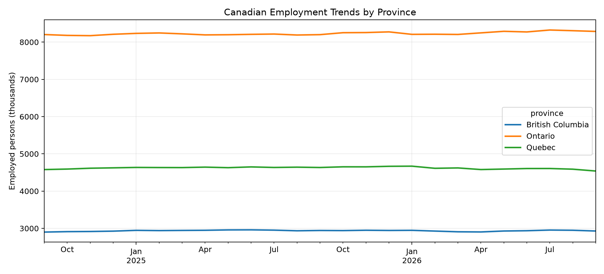
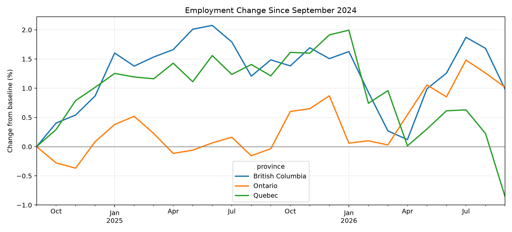

# Canada Employment Analytics

An end-to-end analytics project using Statistics Canada
employment data, Snowflake, dbt, SQL, and Python.

## Architecture

Statistics Canada CSV → Snowflake RAW → dbt Staging
→ dbt Marts → SQL Analysis → Python Charts

## Employment Trends

## Employment Growth Comparison

## Key Findings — September 2026

| Province | YoY Employment Change |
|----------|----------------------|
| Ontario | +1.05% |
| British Columbia | -0.49% |
| Quebec | -2.04% |

## Technologies

- Snowflake
- dbt Core
- SQL
- Python (pandas, matplotlib)
- GitHub

## Data Source

Statistics Canada — Labour Force Survey,
Table 14-10-0287-01.

